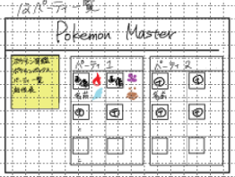

# パーティ画面

## レイアウト

## 基本情報

| 項目 | 内容 |
|---|---|
| 画面名 | パーティ画面 |
| URL | `/party` |
| 認証要否 | 要 |
| 共通ヘッダー | 要 |
| 共通サイドバー | 要 |

## 画面遷移

| 操作 | 遷移先 |
|---|---|
| ヘッダー押下 | ホーム画面に遷移 |
| 図鑑リンク押下 | 検索画面に遷移 |
| ボックスリンク押下 | ボックス画面に遷移 |
| パーティリンク押下 | パーティ画面に遷移 |
| ログアウトリンク押下 | ログイン画面に遷移 |
| タイプ相性表リンク押下 | タイプ相性表モーダルを表示 |
| 戻るボタン押下 | ボックス詳細画面または全画面に遷移 |

## 使用API

| 操作 | API |
|---|---|
| 初期表示 | パーティAPI |
| 図鑑リンク押下 |図鑑API |
| ボックスリンク押下 | ボックスAPI |
| パーティリンク押下 | パーティAPI |
| ログアウトリンク押下 | ログアウトAPI |
| タイプ相性表リンク押下 | タイプ相性表API |
| パーティ名ボタン押下 | パーティ名変更API |
| 画像ボタン押下 | パーティ追加・変更API |

## 備考

- 画像を押した際、「追加する」または「はずず」という候補を表示する

