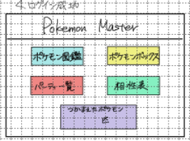

# ホーム画面

## レイアウト

## 基本情報

| 項目 | 内容 |
|---|---|
| 画面名 | ホーム画面 |
| URL | `/home` |
| 認証要否 | 要 |
| 共通ヘッダー | 要 |
| 共通サイドバー | 要 |

## 画面遷移

| 操作 | 遷移先 |
|---|---|
| 図鑑ボタン押下 | 検索画面に遷移 |
| ボックスボタン押下 | ボックス一覧画面に遷移 |
| パーティボタン押下 | パーティ一覧画面に遷移 |
| ログアウトリンク押下 | ログイン画面に遷移 |
| 相性表リンク押下 | 相性表モーダルを表示 |

## 使用API

| 操作 | API |
|---|---|
| 初期表示 | ボックスAPI |
| 図鑑ボタン押下 | 検索API |
| ボックスボタン押下 | ボックスAPI |
| パーティボタン押下 | パーティAPI |
| 相性表リンク押下 | 相性表API |
| ログアウトボタン押下 | ログアウトAPI |

## 備考

- ログイン後はヘッダーにニックネームを記載する

