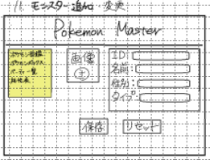

# ボックス追加・変更画面

## レイアウト

## 基本情報

| 項目 | 内容 |
|---|---|
| 画面名 | ボックス追加・変更画面 |
| URL | `/box/form` |
| 認証要否 | 要 |
| 共通ヘッダー | 要 |
| 共通サイドバー | 要 |

## 画面遷移

| 操作 | 遷移先 |
|---|---|
| ヘッダー押下 | ホーム画面に遷移 |
| 図鑑リンク押下 | 検索画面に遷移 |
| ボックスリンク押下 | ボックス画面に遷移 |
| パーティリンク押下 | パーティ画面に遷移 |
| ログアウトリンク押下 | ログイン画面に遷移 |
| タイプ相性表リンク押下 | タイプ相性表モーダルを表示 |
| 保存ボタン押下 | ボックス画面に遷移 |
| 戻るボタン押下 | ボックス画面に遷移 |

## 使用API

| 操作 | API |
|---|---|
| 初期表示 | ボックス追加・変更API |
| 図鑑リンク押下 |図鑑API |
| ボックスリンク押下 | ボックスAPI |
| パーティリンク押下 | パーティAPI |
| ログアウトリンク押下 | ログアウトAPI |
| タイプ相性表リンク押下 | タイプ相性表API |
| 保存ボタン押下 | ボックス追加API |

## 備考

- 必須項目が未入力の時、選択してくださいと表示する

