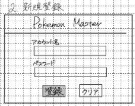

# ユーザー登録画面

## レイアウト

// ここにレイアウト画像を貼り付け

## 基本情報

| 項目 | 内容 |
|---|---|
| 画面名 | 新規登録 画面 |
| URL | `/register` |
| 認証要否 | 不要 |
| 共通ヘッダー | 要 |
| 共通サイドバー | 不要 |

## 画面遷移

| 操作 | 遷移先 |
|---|---|
| 登録ボタン押下 | ログイン画面に遷移 |
| タイプ相性表リンク押下 | タイプ相性表モーダルを表示 |

## 使用API

| 操作 | API |
|---|---|
| 新規登録ボタン押下 | ユーザー登録API |

## 備考

- 入力エラーの場合、以下を表示する
  - アカウント名入力
    - 英数字・平仮名・カタカナのみ入力してください
    - 英数字は全角で入力してください
    - 1~12文字で入力してください
  - パスワード入力時
    - 英数字・記号のみ入力してください
    - 英数字は半角で入力してください
    - 6文字以上で入力してください
