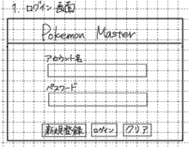

# ログイン画面

## レイアウト

## 基本情報

| 項目 | 内容 |
|---|---|
|ヘッダー|アプリ名記載|
|ニックネーム入力欄|ニックネームを入力する|
|パスワード入力欄|パスワードを入力する|
|ログインボタン|ログインするためのボタン|
|クリアボタン|入力内容をすべてクリアするためのボタン|
|新規登録リンク|アカウントを作成するためのリンク|
| 画面名 | ログイン画面 |
| URL | `/login` |
| 認証要否 | 不要 |
| 共通ヘッダー | 要 |
| 共通サイドバー | 不要 |

## 画面遷移

| 操作 | 遷移先 |
|---|---|
| ログインボタン押下 | ホーム画面に遷移（ログイン成功時） |
| ログインボタン押下 | ログイン失敗画面に遷移（ログイン失敗時） |
| 新規登録リンク押下 | 新規登録画面に遷移 |
| 相性表リンク押下 | 相性表モーダルを表示 |

## 使用API

| 操作 | API |
|---|---|
| ログインボタン押下 | ログインAPI |
| クリアボタン押下 | なし |
| 新規登録リンク押下 | アカウント登録API |

## 備考

- ログイン失敗の場合、※ニックネームまたは、パスワードが違いますと表示する

