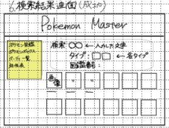

# 図鑑検索結果画面

## レイアウト

## 基本情報

| 項目 | 内容 |
|---|---|
| 画面名 | 検索結果画面 |
| URL | `/zukan/search` |
| 認証要否 | 要 |
| 共通ヘッダー | 要 |
| 共通サイドバー | 要 |

## 画面遷移

| 操作 | 遷移先 |
|---|---|
| ヘッダー押下 | ホーム画面に遷移 |
| 図鑑リンク押下 | 検索画面に遷移 |
| ボックスリンク押下 | ボックス画面に遷移 |
| パーティリンク押下 | パーティ画面に遷移 |
| ログアウトリンク押下 | ログイン画面に遷移 |
| 相性表リンク押下 | 相性表モーダルを表示 |
| 検索ボタン押下 | 図鑑画面に遷移 |
| 画像ボタン押下 | 図鑑詳細画面に遷移 |
| ログアウトリンク押下 | ホーム画面へ遷移 |
| 相性表リンク押下 | 相性表モーダルを表示 |

## 使用API

| 操作 | API |
|---|---|
| 初期表示 | 図鑑検索結果API |
| ポケモン画像ボタン押下 | 図鑑詳細API |

## 備考

- 該当しない場合、見つかりませんでしたと表示する

