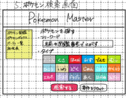

# 図鑑画面

## レイアウト

## 基本情報

| 項目 | 内容 |
|---|---|
| 画面名 | 図鑑画面 |
| URL | `/zukan` |
| 認証要否 | 要 |
| 共通ヘッダー | 要 |
| 共通サイドバー | 要 |

## 画面遷移

| 操作 | 遷移先 |
|---|---|
| 図鑑リンク押下 | 検索画面に遷移 |
| ボックスリンク押下 | ボックス画面に遷移 |
| パーティリンク押下 | パーティ画面に遷移 |
| ログアウトリンク押下 | ログイン画面に遷移 |
| 相性表リンク押下 | 相性表モーダルを表示 |
| 検索ボタン押下 | 検索結果画面に遷移 |

## 使用API

| 操作 | API |
|---|---|
| 初期表示 | 図鑑API |
| 図鑑リンク押下 |図鑑API |
| ボックスリンク押下 | ボックスAPI |
| パーティリンク押下 | パーティAPI |
| ログアウトリンク押下 | ログアウトAPI |
| 相性表リンク押下 | 相性表API |
| 検索ボタン押下 | 検索API |

## 備考

- リセットボタン押下した場合、入力内容をクリアにする
- 検索時、フリーワード入力または、タイプ選択は必須とする

