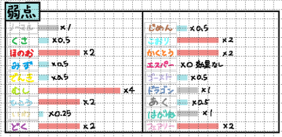

# 弱点画面

## レイアウト

## 基本情報

| 項目 | 内容 |
|---|---|
| 画面名 | 弱点画面 |
| URL | `/weaknesses` |
| 認証要否 | 要 |
| 共通ヘッダー | 不要 |
| 共通サイドバー | 不要 |

## 画面遷移

| 操作 | 遷移先 |
|---|---|
なし

## 使用API

| 操作 | API |
|---|---|
| 初期表示 | 弱点API |

## 備考

- xボタン押下した場合、元の画面に戻る
- 弱点ボタン押下すると、モーダルで表示する

